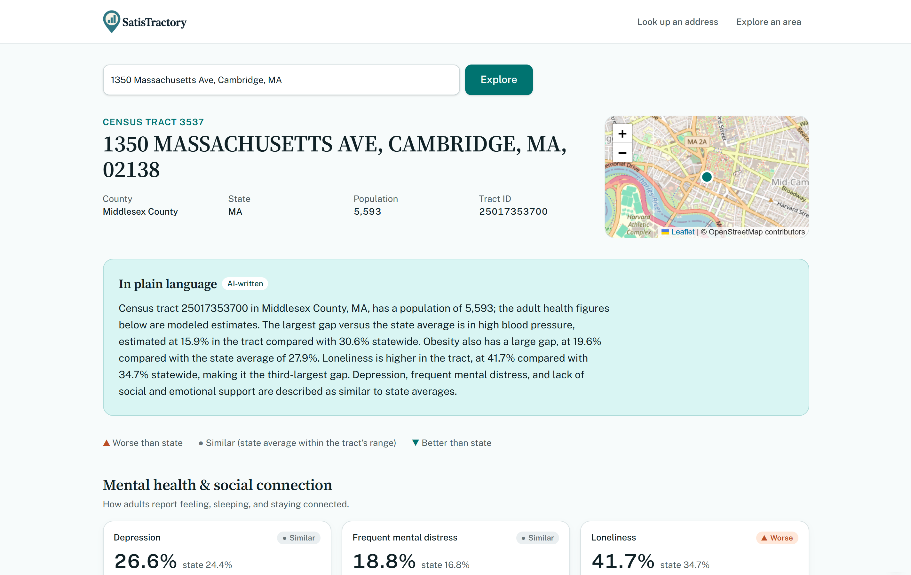
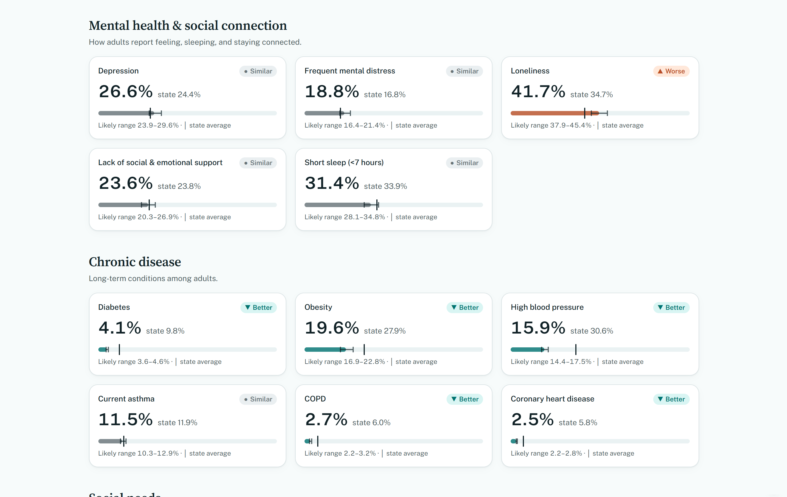
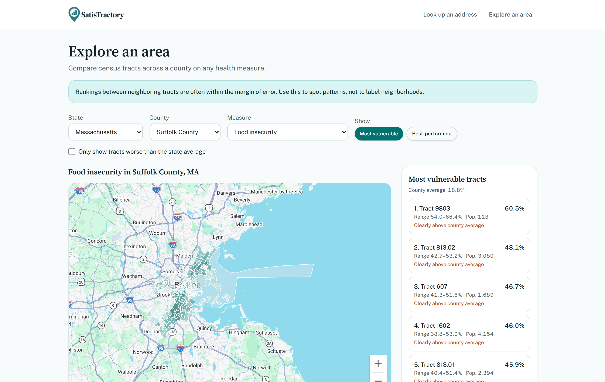
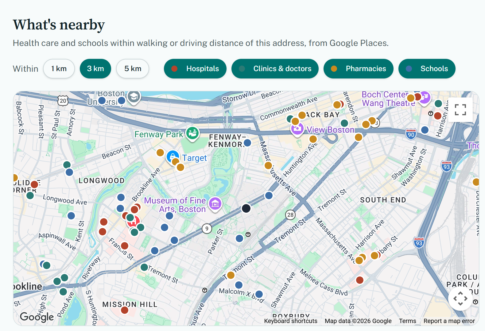
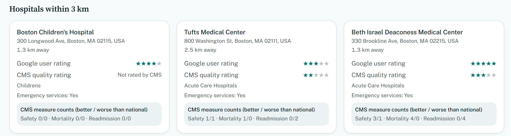

<div align="center">


### Community health, block by block. Because where you live shouldn't predict how long you live.

[](#team)

[](LIVE_DEMO_URL)


**[Live demo](https://satistractory.lovable.app/)** · **[How it works](#architecture)** · **[Handling uncertainty](#handling-uncertainty)** · **[Limitations](#limitations)**

</div>

---

Type **any U.S. address** and see how that neighbourhood's census tract compares to its state average on **19 measures** of mental health, chronic disease, social needs, and access to care. Every number shows its margin of error, and an AI-written summary explains the results in plain language.

[SatisTractory](https://satistractory.lovable.app/) is built for the people who make decisions about neighbourhoods but rarely have time to dig through public health data: residents curious about the place they live, community organizers deciding where to focus outreach, and local policymakers deciding where resources should go. You can look up one address, or switch to the Explorer to see which tracts in a county carry the heaviest burden on any measure.


<p align="center">
  
</p>

<div align="center">

| 🏆 **1st place** | 🗺️ **~79,000** | 📊 **19** | ✅ **13** |
|:---:|:---:|:---:|:---:|
| Lovable Hackathon x Startup Trek | U.S. census tracts covered | health measures per tract | unit tests on the stats logic |

</div>

## The problem

Back Bay and Roxbury are about two miles apart in Boston. In one Back Bay census tract, life expectancy is **92 years**. In one Roxbury tract, it's **69** ([Boston Public Health Commission, 2025](https://www.boston.gov/sites/default/files/file/2025/02/Live%20Long%20and%20Well%20Report_Final_Feb2025.pdf)). *That's a **23-year difference** within one city.*

Gaps like that aren't mainly about genetics or individual choices. They're about things like whether there's a grocery store nearby, whether people can get to a doctor, whether they can keep the heat on in winter, and whether they have someone to call when they're struggling. Public health researchers have a saying for this: "your ZIP code can say more about your health than your genetic code."

The data to see these patterns already exists. Through its PLACES project, the CDC publishes estimates for 40 health measures in roughly 79,000 census tracts across the country. In practice, almost nobody who could act on that data uses it:

- **It's hard to reach.** The estimates are found in government data portals, organized by FIPS codes and measure IDs. A parent or a community organizer shouldn't need to write a database query to learn about their own block.
- **Public tools are disappearing.** In early 2025, the EPA took down EJScreen, one of the most widely used public tools for mapping environmental and health burdens by neighbourhood.
- **It's easy to misread.** These are statistical estimates with margins of error. Ranking neighbourhoods without that context can turn noise into headlines and stigmatize communities instead of helping them.

**SatisTractory puts that data behind a search box, and is honest about what the numbers can and can't tell you.**

See the app [here](https://satistractory.lovable.app/).

## Features

**🔎 Neighbourhood report.** Enter an address and get the tract's 19 measures in four sections, each compared to the state average and labelled *worse*, *similar*, or *better*, with a bar showing the confidence interval.

<p align="center">
  
</p>

**🗺️ Explore an Area.** Pick any county and measure to see a choropleth of every tract, plus a ranked list of the 10 most vulnerable (or best-performing) tracts. A tract is flagged *clearly above county average* only when its whole confidence interval clears the mean.

<p align="center">
  
</p>

**💬 Plain-language summary.** An AI-written paragraph naming the largest gaps. It is generated server-side from numbers the server fetches itself and is instructed to stay neutral, avoid causal claims, and give no medical advice.

**🏥 What's nearby.** Hospitals, clinics, pharmacies, and schools within 1, 3, or 5 km. Official CMS hospital star ratings are shown separately from Google user ratings, so a hospital that's popular online isn't mistaken for one that scores well on federal quality measures.

<p align="center">
  
</p>

<p align="center">
  
</p>

### All 19 measures

| Section | Measures |
|---|---|
| Mental health & social connection | Depression, frequent mental distress, loneliness, lack of social & emotional support, short sleep |
| Chronic disease | Diabetes, obesity, high blood pressure, current asthma, COPD, coronary heart disease |
| Social needs | Food insecurity, housing insecurity, lack of reliable transportation, utility shut-off threat, SNAP receipt |
| Access to care | No health insurance (18–64), routine checkup, dental visit |

## Handling uncertainty

Ranking neighbourhoods by point estimates alone is misleading for small-area data, where neighbouring tracts are often statistically indistinguishable. SatisTractory builds the uncertainty into every comparison:

| Where | Rule |
|---|---|
| Report cards | **Worse / better** only if the state average falls *outside* the tract's 95% CI; otherwise **similar** |
| Explorer | **Clearly above county average** only if the tract's *entire* CI sits above the county mean |
| Measure direction | Configured per measure, so more checkups count as better but more uninsurance counts as worse |
| Choropleth | 5 quantile bins computed per county and measure |

Each of these rules is unit-tested in `src/test/health-compare.test.ts` and `src/test/explore.test.ts`.

## Architecture

```
Browser (React 19, TanStack Router)
   │  calls typed server functions only, never third parties directly
   ▼
TanStack Start server functions        src/lib/*.functions.ts → *.server.ts
   ├── Census Geocoder / TIGERweb      address → tract, 2020 tract boundaries
   ├── CDC PLACES (Socrata API)        tract values + state baselines
   ├── Google Places (via gateway)     nearby facilities
   └── LLM gateway                     plain-language summary
   │
   ▼
Supabase Postgres                      caches: AI summaries, state baselines,
                                       county geometry, nearby places (7-day TTL),
                                       CMS hospital ratings snapshot
```

## Data sources

| Source | Used for |
|---|---|
| [CDC PLACES](https://www.cdc.gov/places/), 2025 release (2023 BRFSS), dataset `cwsq-ngmh` | Tract-level health estimates and state baselines |
| [U.S. Census Geocoder](https://geocoding.geo.census.gov/geocoder/) | Address → census tract |
| [Census TIGERweb](https://tigerweb.geo.census.gov/) | 2020 tract boundaries |
| [CMS Provider Data](https://data.cms.gov/provider-data/) | Hospital overall star ratings |
| Google Maps Platform | Map rendering and nearby places |

## Running locally

```sh
git clone https://github.com/Funkey08/SatisTractory.git
cd SatisTractory
npm install
npm run dev     # start the app
npm test        # run the unit tests
```

The CDC and Census lookups need no keys. The AI summary, Google Maps, and nearby places need API keys (an LLM provider and Google Maps Platform) set as server-side secrets.

## Limitations

- **We use estimates, not measurements.** PLACES values are modelled from survey data and carry real uncertainty, especially in small tracts.
- **Crude prevalence, not age-adjusted.** Student-heavy tracts (e.g. around Harvard and Northeastern) show low chronic disease largely because their residents are young.
- **We focus on descriptions, not necessarily causation.** The app shows where gaps exist, not why.
- **The state average is an unweighted mean of tracts**, not a population-weighted state rate.
- **Hospital matching is heuristic.** A missed ZIP and name match shows as "Not rated" rather than a guessed rating.

## Roadmap

- [ ] Time trends across PLACES releases, and how local policy changes line up with them
- [ ] Food access (USDA Food Access Research Atlas) and air quality (OpenAQ) layers
- [ ] Side-by-side comparison of two addresses
- [ ] Age-adjusted comparisons to remove the student-population effect

## Lovable Hackathon x Startup Trek Winner

Built at the **Lovable Hackathon x Startup Trek** (November 2026), where it won **1st place**.

Scaffolded and iterated on with [Lovable](https://lovable.dev).

---

<div align="center">
<sub>SatisTractory describes neighbourhoods; it does not judge them. It is not medical advice.</sub>
</div>
